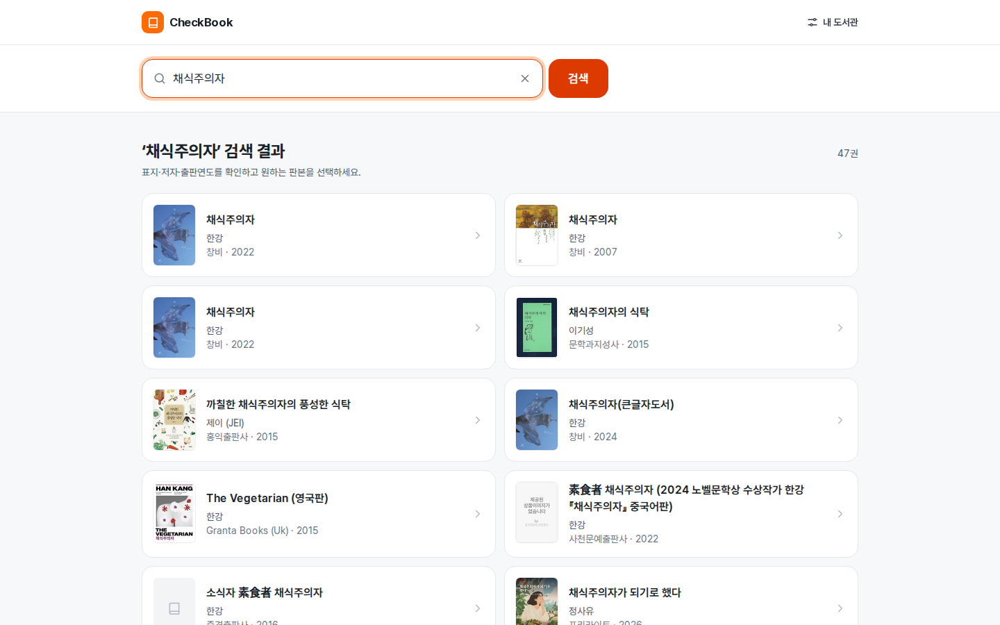
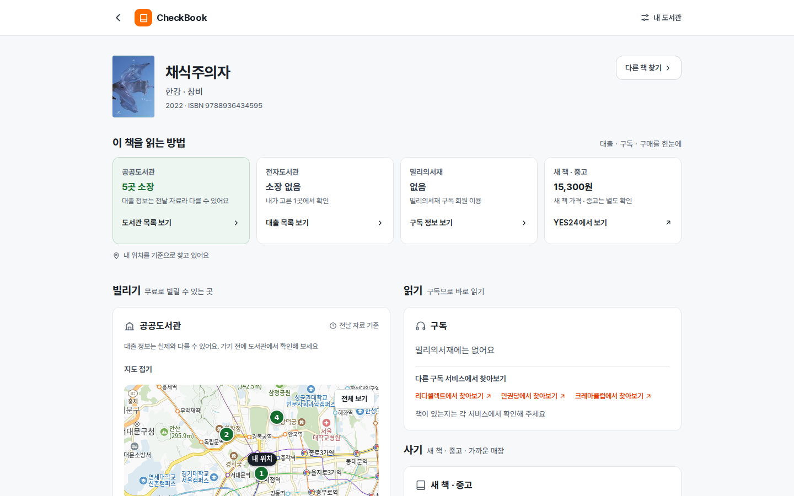
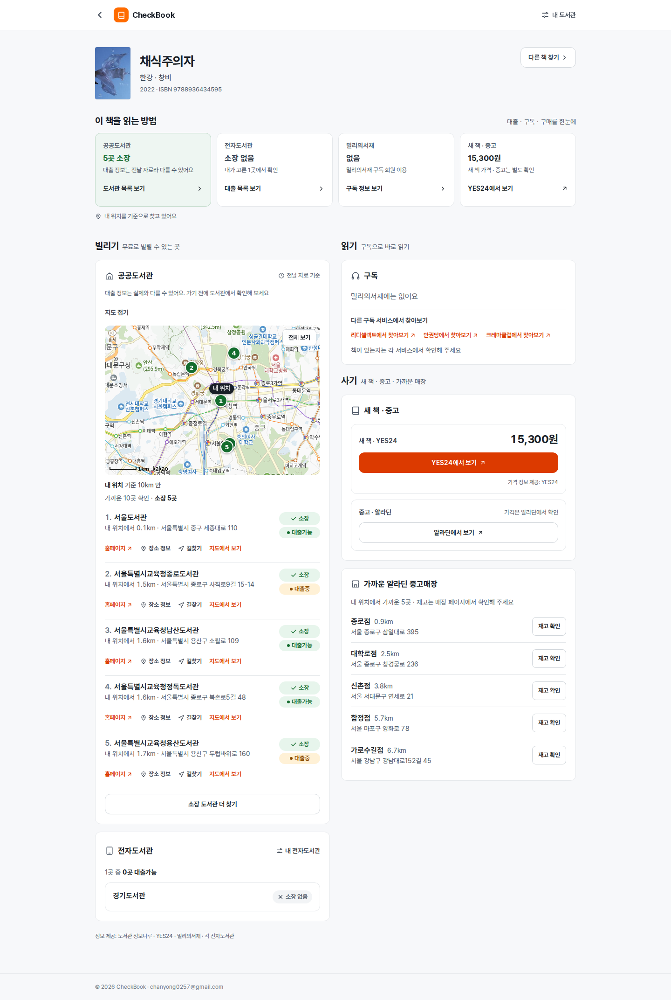
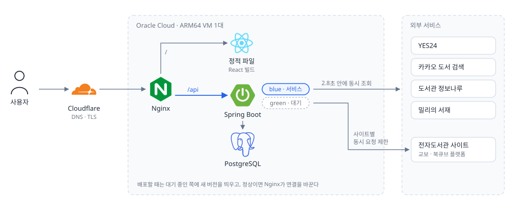
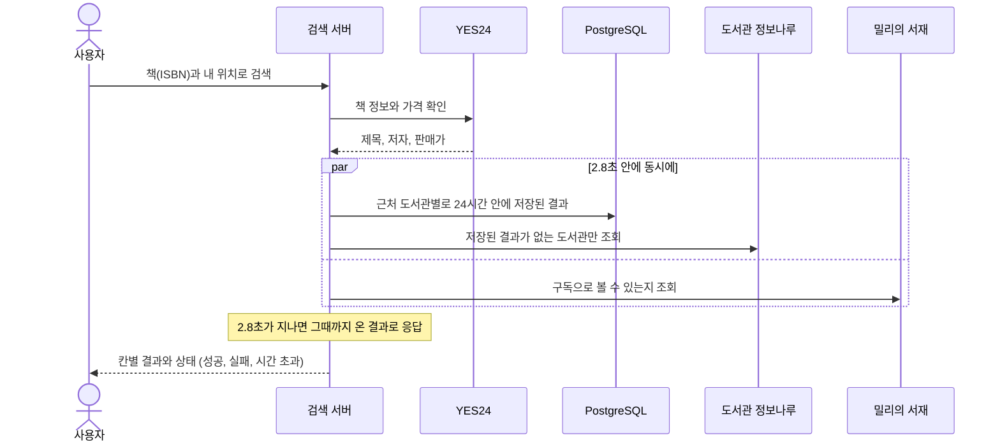

# CheckBook

책 한 권을 검색하면 근처 도서관 소장 여부, 새 책 가격, 중고 매장, 전자도서관, 구독 서비스를 한 화면에 모아 보여 줍니다.

https://checkbook.site

| 메인 | 검색 결과 |
|:---:|:---:|
|  |  |

| 상세 | 상세 (전체) |
|:---:|:---:|
|  |  |


## 만든 이유

독서 동아리에서 모임에 참여할 떄마다 도서관에서 책을 빌리려고 했는데 한군데에 없을 때가 많아 도서관 사이트, 전자도서관, 구독 서비스, 서점을 하나씩 열어서 확인해야 했습니다. 이 확인을 편리하게 한 번의 검색으로 줄여보고 싶어 만들게 되었습니다.


## 기능

| 영역 | 보여 주는 것 |
| --- | --- |
| 책 찾기 | 제목·저자·ISBN으로 후보를 찾고(카카오), 고른 책은 YES24로 확인한다 |
| 공공도서관 | 저장해 둔 내 도서관(최대 5곳)의 소장 여부, 또는 반경 10km 안에서 책이 있는 도서관을 가까운 순으로 찾아 준다. 대출 상태는 도서관 정보나루 기준이라 하루 늦다 |
| 새 책 | YES24 판매가와 상품 링크 |
| 중고 | 알라딘 중고 목록과 가까운 중고 매장 5곳 |
| 전자도서관 | 고른 전자도서관(교보·북큐브 플랫폼)에서 대출 가능한지 바로 조회한다 |
| 구독 | 밀리의 서재에서 볼 수 있는지 확인하고, 리디셀렉트·만권당·크레마클럽은 검색 링크로 연결한다 |
| 메인 | YES24 베스트셀러·신간, 도서관 인기 대출 목록 |


## 구조

<p align="center">
  
</p>
<!-- 원본: assets/architecture.drawio. 고친 뒤 SVG로 내보낼 때 "이미지 포함"을 켜야 로고가 깨지지 않는다 -->

서버 한 대(Oracle Cloud, ARM64)에 모두 올렸습니다. main에 머지하면 GitHub Actions가 테스트와 이미지 빌드를 진행하고, 서버는 새 버전을 대기 쪽 컨테이너에 띄워 정상인지 확인한 뒤 Nginx 연결을 바꿉니다. 운영 절차는 [deploy/README.md](deploy/README.md)에 있습니다.

### 검색 한 번의 흐름



밀리 조회에 책 제목이 필요해서 YES24를 먼저 확인하고 나머지는 동시에 묻습니다. 늦은 곳은 "시간 초과"로 표시하고 나머지는 그대로 보여 줍니다. 중고 링크와 다른 구독 서비스 링크는 외부 호출 없이 서버가 주소만 만들어 제공합니다.

**기술 스택** Java 21, Spring Boot 4.1, JPA, PostgreSQL, Flyway, Resilience4j / React, TypeScript, Vite, Tailwind CSS / Docker, GitHub Actions, Nginx, Cloudflare, Grafana Cloud


## 풀어 낸 문제들

### 같은 책을 동시에 처음 찾으면 저장이 실패하던 문제

도서관 소장 결과는 24시간 저장해 두고 다시 쓴다. 두 사람이 같은 책을 거의 동시에 처음 찾으면 둘 다 "저장된 값 없음"을 보고 동시에 넣으려다 한쪽이 유일 키 충돌로 실패했습니다.

조회 후 저장하는 방식으로는 막을 수 없어서, PostgreSQL의 `INSERT ... ON CONFLICT DO UPDATE` 한 문장으로 변경했습니다. 실제 PostgreSQL 컨테이너에서 같은 상황을 재현하는 테스트를 만들어 확인해봤습니다.

### 외부 API의 하루 호출 한도 지키기

정보나루와 YES24는 하루 호출 수가 정해져 있어서 한 사람이 한도를 다 쓰면 그날 다른 사람은 결과를 못 보게 됩니다.

그래서 외부를 부르는 요청은 IP 하나당 하루 500회로 제한하고 공급자별로 한도 근처에 차단선을 둬서 그 선을 넘으면 사용자 요청으로는 더 부르지 않습니다. 메인 추천 목록 같은 배치 호출은 막지 않고 세기만 합니다.

공급자별 사용량은 처음에 메모리에만 있어서 배포할 때마다 0으로 돌아갔습니다. 지금은 10초마다 DB와 맞춰서 재시작이나 블루/그린 전환 뒤에도 이어서 세게 구현했습니다.

### 실패를 "없음"으로 보여 주지 않기

외부 조회가 실패했는데 화면에 "소장 안 함"이나 "구독 불가"로 나오면 사용자는 틀린 정보를 보게 되어 검색 응답에 칸마다 상태(성공, 실패, 시간 초과, 한도 초과로 건너뜀)를 함께 담아 화면이 "확인하지 못함"과 "없음"을 구분해 보여 주도록 했습니다.

### 전자도서관 사이트를 조심스럽게 조회하기

전자도서관은 공식 API가 없어서 사용자가 조회를 요청할 때 사이트를 직접 검색합니다.

- 사이트마다 동시 요청 수와 하루 횟수 상한을 두고 robots.txt가 막은 사이트는 상한을 더 낮췄습니다.
- 사이트 하나가 전체 응답을 붙잡지 않게 사이트별 마감(5초)과 자리 대기(1초)를 나눠서 두었습니다.
- 교보 계열은 화면 구조가 바뀌면 조회가 조용히 틀리게 되어 매주 무작위 3곳(robots가 허용한 곳)을 실제로 검색해 보고 실패가 늘면 알림이 오게 했습니다.


## 실행 방법

필요한 것: Java 21, Node 22.18 이상, PostgreSQL, 외부 API 키 3개(YES24, 카카오, 도서관 정보나루)

```bash
cp .env.example .env      # 키와 DB 계정을 채워야 합니다.
./gradlew bootRun         # 백엔드 (8080)

cd frontend
npm install
npm run dev               # 프런트 (3000)
```


## 테스트

```bash
./gradlew test            # 기본 테스트
./gradlew postgresTest    # 실제 PostgreSQL에서만 확인되는 동작 (Docker 필요)
./gradlew diagnosisTest   # 타이밍에 따라 결과가 흔들려 기본 실행에서 뺀 동시성 재현 테스트
./gradlew contractTest    # 밀리 API가 그대로인지 확인 (실제 호출, 매주 월요일 자동 실행)
cd frontend && npm test
```


## 한계

- 도서관 대출 상태는 정보나루 자료라 전날 기준.
- 서버가 한 대라 서버 자체가 멈추면 서비스도 멈추게 됩니다.


## 더 보기

- [운영·배포](deploy/README.md)
