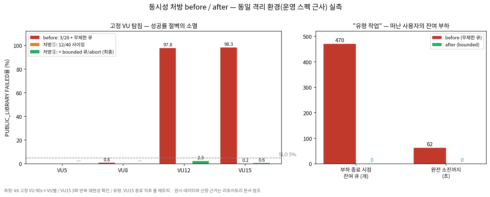

# CheckBook - 도서 통합 검색 서비스

> 읽고 싶은 책의 도서관 소장 현황, 새 책·중고 구매처, 전자도서관 대출 가능 여부, 밀리의 서재 구독 여부를 한 번에 확인할 수 있는 서비스입니다. 여러 사이트를 따로 확인해야 하는 번거로움을 없애고자 개발했습니다.
>
> https://checkbook.site

<br>

## 서비스 화면

| 메인 | 검색 결과 |
|:---:|:---:|
|  |  |

| 상세 - 공공도서관 | 상세 - 중고/전자도서관 |
|:---:|:---:|
|  |  |

<br>

## 주요 기능

- **도서 식별** — 제목, 저자, ISBN으로 카카오에서 후보를 찾고, 고른 책은 YES24로 식별 (YES24에서 못 찾거나 실패하면 카카오 후보 정보로 보조)
- **공공도서관 소장/대출 현황** — 사용자 위치 기반으로 가까운 공공도서관을 5곳씩(더보기로 최대 20곳) 조회해 소장 여부와 대출 가능 여부를 확인 (대출 상태는 도서관 정보나루 기준 전날 자료이고, 조회 결과는 24시간 동안 저장해 다시 씀)
- **새 책 가격** — YES24 판매가와 상품 페이지 링크
- **알라딘 중고 바로가기** — 알라딘 중고 목록 링크와 내 위치에서 가까운 중고매장 5곳(매장별 재고 확인 링크)
- **전자도서관 대출 가능 여부** — 선택한 전자도서관에서 해당 도서의 대출 가능 여부를 실시간 검색
- **밀리의 서재 구독** — 밀리에서 전자책·오디오북으로 볼 수 있는지와 바로가기 링크
- **메인 추천 목록** — YES24 베스트셀러·신간과 도서관 정보나루 인기 대출 (주기적으로 갱신해 저장)

<br>

## Tech Stack

### Frontend


### Backend


### Infra


<br>

## 아키텍처

### 시스템 구조


### 검색 처리 흐름

하나의 검색 요청이 들어오면 여러 외부 소스를 **병렬로** 호출하여 2.8초 내에 응답합니다.


### 배포 파이프라인

서버 한 대(Oracle Cloud A1, ARM64)에 Cloudflare → Nginx → 앱 블루·그린 두 칸 → PostgreSQL로 올립니다. main에 머지되면 GitHub Actions가 테스트·빌드하고, 백엔드는 Trivy 관문을 통과한 이미지만, 프런트는 빌드 결과만 담은 이미지를 GHCR에 올린 뒤 SSH로 서버의 고정 배포 래퍼를 부릅니다. 래퍼가 이미지의 커밋이 main에 있는지·되돌리기 하한선·배포 순서를 확인하고, 백엔드는 블루·그린 전환, 프런트는 릴리스 폴더 링크 전환으로 끊김 없이 바꿉니다. 운영 방법은 [`deploy/README.md`](deploy/README.md)에 있습니다.

(아래 그림은 AWS(EC2·S3·CloudFront) 시절 것입니다.)


<br>

## 설계 결정

| 항목 | 결정 | 이유 |
|---|---|---|
| 공공도서관 조회 | 도서관·책별 결과 24시간 스냅샷 (정보나루 장애 시 지난 값 표시) | 정보나루 대출 상태가 전날 기준이라 짧게 저장해도 정확도 손해가 작고, 같은 책 반복 조회의 호출을 줄인다 |
| 전자도서관 조회 | 실시간 크롤링 | 공식 API 미제공, 대출 상태도 실시간 확인 필요 |
| 검색 타임아웃 | 2.8초 데드라인 | 응답 지연 시 도착한 결과까지만 반환 (graceful degradation) |
| 외부 API 장애 대응 | Resilience4j Circuit Breaker | 도서관정보나루 API 장애 시 연쇄 실패 방지 |
| DB 마이그레이션 | Flyway | JPA ddl-auto 대신 SQL 기반 버전 관리 |
| 배포 | 서버 한 대 + Nginx 블루·그린, 프런트는 같은 도메인 정적 파일 | 무중단 교체, 실패하면 기존 칸·기존 릴리스가 계속 서비스. 이미지는 digest로 고정하고 서버의 고정 래퍼가 커밋 순서·되돌리기 하한선을 검사한다 |
| 스레드풀 사이징 | 3-tier 분리, 12/40/5 | 공유 풀은 중첩 fan-out에서 데드락형 기아(재현 테스트로 증명). 크기는 "동시 요청 × 요청당 태스크"로 산정 후 부하 실측으로 검증 |
| 실행자 큐 | bounded + AbortPolicy | 무제한 큐는 데드라인 지난 "유령 작업"을 적체(실측: 부하 종료 후 62초 점유). 큐 용량은 윈도 산식, 거절 정책은 A/B 실측으로 확정 |
| 종료 처리 | @PreDestroy 블로킹 drain | SIGTERM 경로에서 진행 중 작업 보호는 daemon 여부가 아니라 awaitTermination 예산(5s)이 담당 |

<br>

## 패키지 구조

```
src/main/java/com/checkbook/
├── client/                          # 외부 API 클라이언트
│   ├── yes24/                       #   YES24 (도서 식별, 새 책 가격, 메인 추천 베스트셀러·신간)
│   ├── kakao/                       #   카카오 (책 후보 검색)
│   ├── datanaru/                    #   도서관정보나루 (공공도서관 소장/대출, 인기 대출)
│   └── millie/                      #   밀리의 서재 (구독 여부)
├── search/                          # 통합 검색 (오케스트레이터)
│   ├── controller/
│   ├── service/
│   └── dto/
├── publiclibrary/                   # 공공도서관 도메인
│   ├── domain/
│   ├── repository/
│   ├── service/
│   └── snapshot/                    #   소장/대출 스냅샷 캐시
├── elibrary/                        # 전자도서관 도메인
│   ├── client/                      #   교보문고, 북큐브 크롤링 클라이언트
│   ├── domain/
│   ├── service/
│   └── controller/
├── featured/                        # 메인 추천 목록 (주기 갱신 스냅샷)
├── aladinstore/                     # 알라딘 중고매장 도메인 (가까운 매장 링크)
│   ├── domain/
│   └── repository/
└── common/                          # 공통 (예외, 유틸, 설정)
```

<br>

## 테스트

52개 테스트 클래스 (기본 스위트 49 + 동시성 재현 2 + 성능 비교 1), MockWebServer 기반 외부 API 테스트 포함.

```bash
./gradlew test            # 기본 스위트 (결정적 테스트만)
./gradlew diagnosisTest   # 동시성 한계 재현 테스트 (타이밍 의존이라 분리 태깅)
./gradlew benchmarkTest   # 도서관 순차·병렬 조회 시간 비교 (검증 없이 출력만)
./gradlew contractTest    # 밀리 계약 확인 (실제 API 호출, GitHub Actions가 매주 월 09:17에 실행)
cd frontend && npm test   # 프런트 단위 테스트 (node --test, Node 22.18 이상 — .ts를 그대로 실행)
```

<br>

## 동시성 한계 — 측정으로 찾고, 측정으로 고치기 (2026-07)

검색 1건이 외부 소스들로 병렬 fan-out하는 구조에서 "동시 사용자가 늘면?"에 답하기 위해,
**가설 박제 → 계측 → 부하 재현 → 진단 → 처방 → 재측정**의 사이클을 돌렸다.
측정 환경은 운영 스펙(2vCPU/1GB)을 근사한 격리 compose + 실측 분포로 캘리브레이션한 WireMock.



| 발견한 문제 (실측) | 처방 | 검증 결과 |
|---|---|---|
| 풀이 동시 요청 1건 기준으로 사이징돼 동시 9~11명에서 성공률 절벽 (FAILED 0.8%→97.8%) — 병목은 가설(fan-out 풀)과 달리 상위 오케스트레이션 풀 | ① 사이징 재산정 3/20→12/40 (동시 요청 × 요청당 태스크) | VU12 97.8%→0% (p95 2.46s, SLO 충족). VU15도 FAILED 0.2% (p95 3.31s로 지연 축은 경계) |
| 무제한 큐가 데드라인 지난 "유령 작업"을 적체 — 부하 종료 후에도 큐 470개, 62초간 풀 점유 | ② bounded 큐 + 명시적 거절(abort) | 종료 시점 큐 0, 소진 0초. 용량 초과 유입(open-loop 15rps)에서도 발산 없이 셰딩 |
| 거절 정책 논쟁(abort vs callerRuns)은 코드 논증으로 결정 불가 | 정책을 프로퍼티 주입으로 만들어 장애 주입 A/B 실측 | abort: FAILED 0.05% vs callerRuns: 15.8%·max 41.5s — abort 확정 |
| 1차 큐 용량(40)이 정상 부하에서 도서관 스킵 85%를 유발 — FAILED·latency 지표로는 보이지 않는 조용한 데이터 유실 | 큐 용량을 윈도 산식으로 재산정: (윈도 2.2s − 처리 p50 0.36s) × 소화속도 ≈ 200 | 스킵 85.3%→0.21%, 유령 0 유지 |
| 도서관 20곳 즉시 fan-out이 처리량 천장의 근인 — open-loop 도착률 스윕으로 최대 지속 5.5rps 실측(fan-out 풀 40스레드 포화) | ③ 초기 fan-out 20→5 축소 + 서버 lazy 페이징(더보기 API) | 최대 지속 **5.5→14.5rps (2.64배)**, 옛 붕괴점 8rps가 FAILED 95.6%→0%로 반전. 병목이 설계 예측대로 오케스트레이션 풀로 이동함을 거절↔FAILED 회계 일치로 검증 |

과정에서 지킨 것: 측정 전 가설을 커밋 해시와 함께 박제(예측이 틀린 부분도 기록),
처방은 비용 오름차순으로 하나씩 적용하며 사이마다 재측정(변인 통제),
측정 도구 자체의 결함(모의 서버 스레드 포화, 호스트 시계 표류 등)을 검증해 오염된 수치는
폐기 후 전면 재측정, 판정 임계 근처의 통과는 반복 합산 신뢰구간으로 확정.

그리고 **멈춤도 측정 기반으로 결정**: 목표 수요(1만 DAU ≈ 피크 1.7rps [가정])를 근거와 함께
확정하고, 실측 천장 14.5rps의 여유 8.4배에서 추가 증설을 의도적으로 유보 — 다음 병목의 위치와
예상 천장(≈22.5rps), 재개 트리거(실사용 피크가 천장의 50% 도달)까지 산정해 문서로 박제했다.
"얼마나 버티나"보다 "얼마가 필요한가"를 먼저 답하는 것이 용량 계획이라서다.
